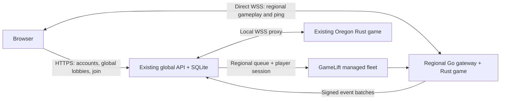

# Bolts multiplayer operations

Rust owns every multiplayer combat decision. Local development and the legacy deployment use one Rust process for all lobbies. The GameLift configuration below runs one managed game session per process, with a shared directory and account database. The TypeScript client remains a static web app. **Single player** runs the local AI simulation without a multiplayer connection. The main menu can fetch the public online count and leaderboard; feedback is submitted only on request. Optional visitor tracking also records page opens and visible-page heartbeats independently of game sessions; failure never prevents local play.

The complete game and its assets are hosted at **https://play-bolts.github.io/**. Multiplayer uses **https://bolts-api.christopherkrapu.com** and its corresponding WSS endpoint. GitHub Pages serves the frontend; the existing Oregon AWS server handles the API, lobbies and persistence.

## GameLift regional hosting

Regional implementation prepared on 2026-10-16; **the GameLift fleet has not been deployed**. [DEPLOYED.md](../infra/DEPLOYED.md) remains the record of live infrastructure. New York was excluded at the user’s request after its GameLift allowance remained zero. London, Singapore, São Paulo and the fleet home region each report a 400-instance allowance. The template keeps one warm instance in each requested city and caps each at two. See the [zero-player pricing estimate](../research/regional-hosting-costs.md): approximately $336/month for the three new locations, plus the unchanged Oregon baseline.

| Location shown in the browser | GameLift location |
| --- | --- |
| Oregon | `us-west-2` (existing Rust server; no additional managed instance) |
| London | `eu-west-2` |
| Singapore | `ap-southeast-1` |
| São Paulo | `sa-east-1` |

The [Go supervisor](gamelift/main.go) uses the official GameLift Server SDK 5.6.0 around the existing Rust simulation. Its `directory` mode runs on the existing private EC2/CloudFront backend, keeps the existing SQLite database, token hashes, leaderboard seeds, feedback, analytics and backups, and combines its existing Oregon games with the three new regional locations for every viewer. Its `game` mode runs alongside one Rust child on each GameLift server process. Regional gameplay connects directly to the GameLift hostname over TLS WebSockets on port 8080 or 8081. Oregon gameplay keeps its existing same-origin WebSocket path through the directory to the local Rust process. Existing account credentials, scores and activity records stay in the same database.



The **Location** column and picker show the full city name with a country flag. The list contains actual active or starting sessions, with no sleeping placeholders. The **Location** picker and **Play** button offer the configured managed cities even when those cities have no active games. Oregon remains joinable through its actual lobby rows; it does not request GameLift capacity. Everyone sees all lobbies regardless of their selected location. The browser measures the median of three nonce-matched WebSocket echoes against each running endpoint, excluding connection setup. Measurements are local to the viewer and never cached in the global directory. The gateway forwards WebSocket control frames too, preserving the server's authoritative scoreboard RTT. Browser probes and directory reads never allocate player seats or start instances. Joining another continent is always allowed.

Each region has an exact-location queue with a 600-second placement timeout; there is no fallback to a different city. **Play** reuses the player's existing reservation, then fills the busiest open lobby in the selected location. If all lobbies there are full, or none exist, it automatically requests another game in that location. A last-seat race tries the remaining lobbies before requesting capacity. Concurrent arrivals share one pending placement, whose ID is saved across directory restarts. The client shows **Starting server…** while polling and can cancel. With a warm instance, an available process can start a game without waiting for a new EC2 host; this is still subject to session activation and available capacity. Cancellation stops that client's join; a shared placement may still finish for other waiting players. A five-minute HMAC ticket admits the account's UUID to its reserved GameLift player session. The browser's permanent account token stays on the directory. Disconnections keep the GameLift seat for the same 30-second grace period as Rust; explicit leave frees it immediately, and reconnects refresh the admission ticket.

The version-2 `GET /api/lobbies` response includes `locations: ["lon","sg","sp"]` separately from `lobbies`, which includes existing Oregon rooms as `location: "or", managed: false`. `POST /api/join` with `lobbyId: "new:<location>"` means join-or-start in that location; that routing key is never a listed lobby. Selecting an actual lobby still joins that exact game. New game allocation is driven by a player's join request, so a full lobby does not continuously create unused replacement games.

The fleet uses on-demand `c7i.large` instances with two server processes each. One session can run successive rounds indefinitely while occupied. Empty sessions close after the Rust five-minute idle timeout and disappear on the next directory refresh (the API cache and browser polling each have a five-second interval). The instance stays ready with minimum and desired capacity of one; automatic scale-to-zero is disabled. Idle sessions and idle instances are separate: zero players still incurs the warm-instance cost. A 20% spare-session target scales above one instance, bounded at two instances per location by default (four lobbies / 24 human or spectator seats per location). Active game sessions have termination protection. The `us-east-1` home location has zero desired and maximum capacity and is absent from all placement queues. The central API and its storage continue to incur their existing baseline cost alongside the warm regional instances.

### Build and verify

Use Go 1.27.2, Rust 1.99.0, Node, Python 3.9+ and Docker. The build script copies only an explicit source allowlist into Docker. Rust is compiled on Amazon Linux 2023; Go is a static Linux executable. GameLift never compiles code during a cold start.

```sh
npm test
npm run build
PYTHONPYCACHEPREFIX=artifacts/pycache python3 -m unittest discover -s tests -p 'test_*.py'
cargo test --locked --manifest-path server/Cargo.toml
cargo build --locked --manifest-path server/Cargo.toml
BOLTS_TEST_SERVER="$PWD/server/target/debug/bolts-server" go -C server/gamelift test -race -v ./...
python3 scripts/prepare-gamelift.py --account-id 780705957578 --preflight
python3 scripts/prepare-gamelift.py --account-id 780705957578 --build
```

The preflight is read-only and returns a nonzero status until all locations are enabled and have sufficient allowance. Build outputs, SHA256 manifest, generated CloudFormation template and sanitized configuration are under `artifacts/gamelift/`. The integration test launches two real Rust processes and a Go WebSocket gateway, verifies an intentionally delayed browser heartbeat, reconnect and seat release, then replicates events into the central database without replacing its account credentials. It needs permission to bind localhost sockets.

### Rollout order

The resumable deployment helper implements the steps below. Its default is local validation only; `--check` reads AWS, and `--apply` explicitly performs the selected phase. It verifies bundle checksums, current source provenance, Linux architecture and the exact three warm locations before upload. It stores build, fleet and cutover identifiers under `temp/gamelift-deploy/` so interrupted operations resume without blindly creating replacements. Temporary upload credentials and the cluster secret never enter its state files or logs.

```sh
python3 scripts/deploy-gamelift.py --check
python3 scripts/deploy-gamelift.py --apply --phase build
python3 scripts/deploy-gamelift.py --apply --phase fleet
python3 scripts/deploy-gamelift.py --apply --phase directory --expected-release CURRENT_RELEASE_SHA256
```

The directory phase discovers the existing backend role, instance and private release bucket, finalizes the fleet ID, and uses the guarded S3/SSM installer. If `--expected-release` is omitted, it reads and pins the current release before deployment. It refuses an occupied lobby. A failed cutover is retained for inspection rather than automatically retried.

1. Run the read-only preflight and confirm at least two `c7i.large` On-Demand instances are allowed in each requested city. New York is excluded; no quota request or paid resources are created there. [AWS location reference](https://docs.aws.amazon.com/gameliftservers/latest/developerguide/gamelift-regions.html).
2. Create `/bolts/gamelift/cluster-secret` as an SSM **SecureString** in `us-east-1`, using a cryptographically random value of at least 32 characters. Keep the value out of shell history, build files, CloudFormation parameters and logs; use a private temporary `--cli-input-json` file and remove it afterward. Preserve the value on subsequent deployments: replacing it immediately invalidates tickets and replication signatures on running servers. The generated game role and central-directory policy grant only `GetParameter` access to this parameter.
3. Build the Linux bundle. Upload `artifacts/gamelift/bundle` with GameLift `upload-build`, specifying `--operating-system AMAZON_LINUX_2023 --server-sdk-version 5.6.0`. The bundle contains only the two executables, `host.json` and `install.sh`. Record the returned build ID. Configuration uses the default stack name `bolts-gamelift`; if changing that name, regenerate the bundle with `--stack` before upload.
4. Deploy `artifacts/gamelift/fleet.template.json` to `us-east-1`, with parameters `BuildId` and `DirectoryRoleName` (the existing `bolts-backend` EC2 `InstanceRole` physical resource name), and capability `CAPABILITY_NAMED_IAM`. Wait for every location to become active. The generated template includes TLS, the three queues, capacity limits, scaling policies and role policies. Review fleet events if validation fails; avoid retrying fleet creation blindly.
5. Read the stack's `FleetId` output. Generate the directory configuration with `python3 scripts/prepare-gamelift.py --account-id 780705957578 --fleet-id fleet-…`. The top-level `artifacts/gamelift/host.json` now contains the actual fleet ID. The already uploaded worker bundle does not need that ID: the Server SDK supplies its session and fleet context.
6. Deploy the protocol-3 frontend, Rust backend and regional gateway as a coordinated release; protocol-1/2 clients are rejected. Keep the previous complete release available for rollback. Use the existing private S3/SSM release path to deliver the checksum-verified Linux binaries, finalized directory configuration and [install-directory.sh](../infra/gamelift/install-directory.sh). On the EC2 host, invoke it with the release SHA256, unpacked bundle directory and configuration path and the expected current release SHA256. It holds the shared deployment lock, refuses occupied lobbies before and after backup, takes the existing backup, preserves the database and salt, installs a systemd drop-in, and rolls back binaries/configuration if restart or the configured-location directory health check fails. This check also verifies that local Oregon rooms are correctly identified. The old Rust-only installer refuses to overwrite a GameLift directory.
7. Smoke-test each location with two browser identities: warm placement, a TLS connection, both viewers seeing the same global list, different actual RTTs, chat, combat, reconnect, and a name/score surviving a move between regions. Confirm `DescribeGameSessions.Location` matches the selected city. Leave each session, verify it ends while its instance count returns to exactly one, and check that occupied sessions survive scale-in. Load-test two simultaneous six-seat games on one instance before raising the configured cap.

CloudFormation validation and local integration tests do not exercise AWS capacity allocation, TLS issuance or real cross-region latency; the regional smoke tests are required for rollout. New builds replace fleets. Drain active sessions before switching the directory's fleet ID. Old fleets are retained by the template so a stack update cannot silently terminate active games; after draining, explicitly remove retired fleets to avoid retained-resource costs. Generated fleet certificates expire after 13 months, so replace fleets before then. [AWS fleet reference](https://docs.aws.amazon.com/AWSCloudFormation/latest/TemplateReference/aws-resource-gamelift-fleet.html).

### Persistence and recovery

Workers use private, per-process SQLite files under `/local/game/sessionlogs/`. Every five seconds, outside the simulation tick, they send signed batches to `/api/cluster/replicate`. The directory validates the signature and timestamp and imports in a transaction. Event UUIDs, combat-role keys and per-session cursors make retries idempotent. Human account credentials and private feedback never enter a batch. Shared leaderboard totals are incremented from new combat events, preserving existing scores and launch seeds. Regional membership grace periods may overlap during a server change; the database uniqueness constraint is per player and lobby, while each local Hub still owns a single membership per identity.

Migration 4 records imported session and connection ownership in `cluster_cursors` and `cluster_connection_owners`. Restart recovery closes only records owned by the process: restarting Oregon leaves running regional sessions open, while a worker restart still produces its genuine leave events. Explicit socket ownership also covers authenticated connections that have not yet joined. Previously imported joined sockets are backfilled from their recorded lobby events; new deployments establish ownership before regional records are imported.

Replication is asynchronous: the directory can lag behind a game by several seconds, and an outage leaves unacknowledged records on the worker. A graceful process termination closes the Rust records, flushes a final batch and writes credential-free `final-replication.json` alongside the checkpoint database for GameLift session-log recovery. Keep these session logs private: they contain player activity and chat. If a final upload failed, recover the batch from that session's GameLift logs and submit it to the same replication endpoint with a fresh `X-Bolts-Time` and `X-Bolts-Signature` (hex HMAC-SHA256 of `replicate:<timestamp>:<exact JSON bytes>` using the SSM secret). Replaying an already imported batch is safe. If a process or instance dies before flushing, recovery depends on the retained local/session logs; this is not a synchronous guarantee for the latest few seconds. Existing central SQLite/S3 backups remain the authoritative recovery path for acknowledged data.

The loopback `/internal/cluster` API requires a fresh private supervisor token and cannot be enabled on a public Rust bind. The public Go directory proxies only the intended community and Oregon gameplay routes; it never exposes this bridge. Trusted proxy handling preserves CloudFront's appended viewer address centrally and uses the direct socket peer on game servers. Public probe connections are origin-checked, size/time-bounded and rate-limited. [AWS scale-to-zero behavior](https://docs.aws.amazon.com/gameliftservers/latest/developerguide/fleets_scale-to-from-zero.html), [Server SDK integration](https://docs.aws.amazon.com/gameliftservers/latest/developerguide/integration-server-sdk-go-actions.html).

## Local development and verification

Use Rust with Cargo and Node 22.13 or newer. From the repository root:

```sh
cargo build --locked --manifest-path server/Cargo.toml
BOLTS_DB=server/data/bolts.sqlite cargo run --locked --manifest-path server/Cargo.toml
```

In a second terminal:

```sh
npm ci
VITE_MULTIPLAYER_URL=http://127.0.0.1:8080 npm run dev
```

Open `http://127.0.0.1:5173`. For two independent browser identities, use separate browser profiles or the separately allowed `http://localhost:5173` origin. Two tabs on the same origin share one identity; the newer connection replaces the older one. Team and weapon selection happen before joining, so the player cannot be killed while selecting the initial loadout.

```sh
npm test
npx tsc --noEmit
cargo test --locked --manifest-path server/Cargo.toml
python3 -m unittest discover -s tests -p 'test_origin_config.py'
node --import tsx scripts/test-multiplayer.mjs
node --import tsx scripts/test-spectator-lean.mjs
BOLTS_TEST_URL=http://127.0.0.1:8080 node --import tsx scripts/test-network-adapter.ts
```

`test-multiplayer.mjs` starts an isolated server/database by default and checks seven users, capacity allocation, room isolation, real movement and headshots, rate/sequence limits, reconnect, expiry and persisted event relationships. `test-network-adapter.ts` exercises two actual frontend networking adapters against an already running test server, including prediction, interpolation, ADS, reload, chat and returning to local AI. These scripts create real test identities and events. Setting `BOLTS_TEST_URL` on the first script targets an existing deployment; database inspection and accelerated idle-expiry checks are then omitted.

`test-spectator-lean.mjs` always starts an isolated local server and two real WebSocket clients. It checks spectator admission, rejected combat input, chat, mode transitions without deaths, persisted mode events, and ordinary movement to a wall followed by stable camera-safe lean. Its temporary database is removed afterward.

`tests/network-timing.test.ts` checks start/stop prediction at 30, 60 and 144 FPS with latency, jitter and frame stalls. Rust input tests verify the actual scheduled queue, while both languages consume `tests/fixtures/movement-parity.json` to check matching movement, stance, jumping and collision. Regenerate those fixtures deliberately with `node --import tsx scripts/generate-movement-fixtures.ts` when movement rules change. `node --import tsx scripts/test-multiplayer-clients.ts` exercises three actual frontend adapters against an isolated local server, with 80 ms of added delay in each direction on one connection.

## Simulation and connection behavior

- Bash attacks resolve at the animation's contact peak (about 283 ms for rifles, 241 ms for grenades), using the attacker's current position and a 2.5 m reach with a 0.5 m sweep radius. Contact still requires an unobstructed body surface. Roll out the frontend and backend together and refresh already-open clients: the optional `Shot.impactOnly` contact cue preserves protocol 3 gameplay data, but older clients may replay the swing animation/sound when contact arrives.
- The server simulates at **60 Hz** and normally broadcasts snapshots at **20 Hz**. It accepts movement/action intent, never client positions, hit claims, health or scores. Clients assign each command to a simulation tick; a bounded queue preserves catch-up inputs and a missing tick uses neutral intent. Rate limits, monotonic sequences/ticks and one command per tick prevent packet replay from multiplying movement or actions. Only internal AI uses held inputs with a 250 ms timeout; network clients must use protocol 3. Scheduling slack adapts from 2–8 ticks using authority feedback. See [the protocol](PROTOCOL.md).
- Clients predict local movement and provisional weapon presentation on a separate tick clock, then restore authoritative state and replay ticks after each snapshot. Small corrections are smoothed only in the camera, with interpolation between local physics steps. Remote display uses a monotonic 100–180 ms adaptive interpolation clock with bounded recovery; prediction collisions use separate authoritative samples and bounded extrapolation. Roster changes preserve local prediction. Hits use server-side obstruction/body tests and at most 200 ms of target-history rewind. Killcams use received authoritative snapshots and shot events.
- Each lobby has **six total slots**, including spectators. One or two connected humans receive two AI opponents; at three connected humans the AI leave, and empty rooms have no AI. Reconnecting/arriving humans take priority, and bot fill respects seats reserved during reconnection. Spectators count as humans for this threshold; disconnected reservations do not. Lobby names combine a German general and a Greek letter. Listing rooms maintains available capacity without creating a room on every refresh.
- Online bots use ordinary authoritative movement, ammunition, reload, damage and collision. Their perception samples line of sight and a forward view cone, with reaction delays, correlated aim error, limited memory, navigation and cover choices. They receive no client sockets or authentication credentials. Snapshots mark them with `bot: true`; lobby lists report their count separately from human seats.
- Spectators keep chat and room membership but have no colliding or damageable body. Entering spectator mode clears combat intent without changing kills/deaths; selecting a loadout returns them to a protected combat spawn. Spectator mode persists across reconnects and round restarts, and spectators are excluded from the round winner. Camera following and free movement are local presentation only.
- Lean sweeps a camera-clearance segment against cover and arena walls, preserving a stable partial lean when blocked. Client prediction, rendered eyes, and Rust authority share the same geometry and 0.16 m clearance; leaning changes position without rotating the view.
- Empty rooms close after **five minutes**. A disconnected player keeps their seat for **30 seconds**, with neutralized input; explicit departure releases it immediately. Client reconnection uses bounded backoff. Reconnecting within the grace period retains the actor, score and ammunition.
- Rounds last five minutes and restart after eight seconds. Online menus/chat stop local input while the server continues. A midmatch faction change costs a death and uses normal respawning, preventing free healing/ammunition resets.

Socket readers and writers run independently. Protocol 3 sends lossless MessagePack input and snapshot tuples using `shared/actor-fields.json` and `shared/wire-schema.json`; no quantization or delta baseline is required. The Hub captures typed actor state and reserves publication order under its lock; writers encode each immutable shared payload once outside the Hub and outbox locks. Inbound inputs and typed JSON controls are decoded before acquiring the Hub lock. One replaceable unsent snapshot prevents obsolete state from accumulating. Catch-up executes every retained step but captures only the freshest due snapshot at the end of a batch, with a wall-clock publication gate across batches. The scheduler retains at most 30 ticks of debt and logs severe-overload time discarded explicitly.

Shot/hurt/reload/bolt/switch cues publish every simulation tick when present, independently of the snapshot cadence and pending database commits. The client applies cosmetic effects immediately for a matching actor life, retaining authoritative shot times for replay; unknown future lives get a bounded 250 ms hold. HP, scores and killcam transitions remain state-led. Kill/spawn/end and chat notifications keep their reliable ordering and persistence guarantees. Reload audio uses a short presentation lease until the matching state arrives. A protocol-2 browser must reload; its saved identity remains valid.

The isolated six-player transport probe (`node --import tsx scripts/measure-transport.ts 20`) measured 82% smaller inputs and 60% smaller snapshots than the previous JSON encoding of exactly the same state. Observed downstream traffic was 39 kB/s per player versus 93 kB/s in the earlier audit. After a 101 ms process pause, snapshot arrival gaps were 47–54 ms rather than the earlier sub-millisecond catch-up burst. Combat cues generally arrived 18–34 ms before their matching snapshot when emitted between snapshot ticks. These are local transport measurements, including WebSocket framing but excluding TLS/TCP/IP overhead; they do not establish Internet latency or packet-loss performance. The probe records its binary hash, raw captures, population scenarios and separate 101/500 ms stall traces under `temp/transport-audit-v3/`.

Accepted game sockets disable TCP Nagle batching with `TCP_NODELAY`, so small combat cues and ping replies do not wait for another packet or a delayed acknowledgement. This removes an avoidable source of server-side delay; it does not eliminate packet loss, Internet route variation or browser frame stalls.

For timing diagnostics, enable `RUST_LOG=bolts_server=debug`. Five-second simulation reports include catch-up/dropped ticks and maximum lock/tick duration and scheduler delay; socket close reports include replaced snapshots and queue age. Production logs also warn at most once per five-second reporting interval when lock/tick work reaches 50 ms, scheduling delay reaches 100 ms, or ticks are dropped. `NetworkClient.diagnostics` exposes RTT, input lead, server arrival feedback, interpolation target/underruns, correction distance and buffered bytes. Shot rewind remains capped at 200 ms; `rewindClamped` identifies when the displayed target age exceeds that fairness budget. Client rendering still drives input generation, so a blocked main thread can interrupt input production; WebTransport and a worker-owned input loop are separate follow-up experiments.

`node --import tsx scripts/probe-latency.ts https://bolts-api.christopherkrapu.com temp/latency-probe.json` records 36 short WebSocket RTT probes over 12 connections, including median/p95/max and individual samples. It uses `/api/ping` without creating an account, lobby or seat. Run from the affected player's machine to measure that route; its results exclude gameplay/rendering load. Pair reports of spikes with the timestamp, region, client diagnostics and server latency warnings.

Run `node --import tsx scripts/test-multiplayer-clients.ts` after building the local Rust binary. It exercises three actual frontend adapters, two-way combat/killcams, a 160 ms RTT connection, asymmetric ordered delivery stalls, SQLite write contention, durable chat/scores and disconnect cleanup. Clock tests additionally reproduce delivery bursts and RTT steps with realistic initial snapshot transit.

The complete HTTP/WebSocket shapes are in [PROTOCOL.md](PROTOCOL.md). Authentication travels in the first WebSocket message rather than a URL parameter. Browser-origin checks, bounded messages and chat limits apply before broadcast. Chat is room-scoped, limited to 256 Unicode characters and three messages per five seconds; the UI renders chat bodies as text.

## Identity and persisted data

The server issues a random UUID plus a separate opaque secret. The browser keeps the secret in origin-scoped local storage; SQLite stores its SHA-256 hash. A UUID or display name alone cannot authenticate. Clearing browser storage creates a new anonymous identity. There is no browser fingerprinting or IP-derived player ID, so an IP change does not change the player's identity.

Connection metadata stores keyed HMAC-SHA256 values for the observed IP and user agent, not their raw values. `BOLTS_IDENTITY_SALT` remains on the server and inside private backup archives. Trusted proxy mode is valid only behind the restricted origin ingress; it must stay off for an unrestricted direct listener.

[Schema](schema.sql) uses foreign keys, WAL mode and `synchronous=FULL`. Timestamps are server-generated UTC epoch milliseconds. UUIDs identify entities and events; `events.seq` provides ordered pagination, while `schema_version` versions each event payload.

| Table | Meaning and relationships |
| --- | --- |
| `players` | Persistent UUID, credential hash, latest display name, indexed canonical `name_key`, first/last seen times and `is_bot` marker. Server-only bot keys reuse bot UUIDs without allowing authentication. |
| `connections` | Socket lifetime, end reason and keyed network metadata; references a player. |
| `lobbies` / `matches` | Room lifetime and successive rounds, including final winner and termination reason. |
| `memberships` | One continuous room visit, actor ID, name/faction at join and leave reason. A partial unique index prevents two active memberships for one identity in the same lobby. |
| `match_players` | Per-round participant names, factions and kills/deaths/shots/hits. |
| `events` | Typed append-only activity with optional room, match, connection, actor and target references, plus versioned JSON detail. |
| `chat_messages` | Chat body and display name at send time; its primary key also references the corresponding chat event. |
| `combat_events` | One kill record linking the killer, victim, weapon/headshot and separate `player_kill` / `player_death` events. |
| `leaderboard_names` | Canonical name primary key, plain display name and transactional all-time kills/deaths; ranking index orders kills, deaths and name. |
| `leaderboard_events` | Combat-time name and timestamp for each human kill/death role, unique per combat/role. Name/time and time/name indexes support rolling 24-hour totals. |
| `leaderboard_seeds` | Operator-created contribution ledger keyed by seed ID and canonical name. Tracks synthetic all-time launch scores independently of real combat and identities; created by the seed utility, not the gameplay migration. |
| `feedback_requests` | Private required message, optional email, keyed network pseudonym and submission time. Indexed by network/time for a persistent hourly limit. |
| `feedback_events` | Private append-only submitted event referencing its feedback request; committed with the request and containing no message/email copy. |
| `visitors` | Random browser UUIDv4 with first/last server receipt times. No link to player identities, names or network metadata. |
| `visitor_activity` | One row per visitor and UTC minute, preserving first/last receipt times within that minute. Indexed by last receipt and visitor ID for historical window queries. |
| `schema_migrations` | Applied schema version metadata. |

Event types cover server start/stop, player enter/leave/reconnect, profile/loadout changes, chat, kill/death and round end. A dedicated bounded SQLite worker keeps database latency outside the simulation mutex. Gameplay writes retain FIFO order and priority over queued optional HTTP work. Chat and its event commit together before broadcast. Kill/death pairs and their combat record commit in one transaction; their notifications wait for that commit while simulation and snapshots continue. Snapshots can temporarily show an outcome before its durable notification. Orderly shutdown drains all accepted writes; a hard crash can lose queued, not-yet-published records. Membership leave events are idempotent. A persistence failure stops the service instead of continuing matches without their event history.

Leaderboard rows aggregate by the name used at the time of combat. `^0`–`^9` color codes are removed, whitespace is collapsed, and lowercase keys group capitalization variants. The first plain spelling is retained for display. Equal names share a row; a name is not an account or proof of ownership. Renaming starts credit under the new name without moving historical totals. `Unknown Soldier`, blank names and bot rows are omitted. Human kills against bots and deaths to bots count. Self-kills, including faction changes, count as deaths and award no leaderboard kill. Both tables include named players with zero scores; ties sort by fewer deaths, then canonical name. The 24-hour table counts each role within the server's rolling UTC window, not a calendar day.

Schema migration 2 is additive and transactional. It adds bot/name columns and indexes to existing player tables, then backfills scores from existing combat records using ordered join/profile names. If an old combat has no name event, it falls back to its recorded round name and then the preserved player name. It never invents combat records or infers missing kills/deaths from incomplete round totals. A unique combat/role key and migration marker prevent double counting on restart; original UUIDs, credentials and events remain intact.

Schema migration 3 atomically adds the two visitor tables, their time index and migration marker. It preserves all existing game records and leaderboard seeds. Visitor writes are a separate transaction: a failure returns 503 without stopping matches. No historical visits are inferred or backfilled.

The production frontend sends `{visitorId}` at startup, every 60 seconds while visible, and once on hiding/leaving when possible. It stores a random ID under `bolts.visitor.v1` in local storage; no fingerprint, IP, user agent, name, URL, referrer or multiplayer credential is included or stored in the visitor tables. Browser privacy signals disable tracking, as does `?visits=0`; development and QA pages are disabled by default. The endpoint requires an exact allowed Origin and limits requests to 60 per minute per network address in memory. This deters accidental traffic but is not authentication or proof of a human visitor. There is no public visitor-read API. See [analytics and privacy](../research/user-analytics.md).

Feedback accepts 1–2000 trimmed Unicode characters and an optional validated email of at most 254 ASCII bytes. Requests are limited to three attempts per minute and five accepted submissions per hour per keyed network address, with the hourly limit surviving restarts. Browser origins use the same exact allowlist as multiplayer. No public API reads feedback or contact details, and responses return only the request UUID. Authorized operators can inspect these tables through the existing private database/backup path; no email is sent automatically.

Spectator admission is recorded in `player_enter.data.spectator`; later mode changes use `loadout_change` data containing `faction` and `spectator`. These transitions do not create combat records or synthetic deaths, and require no database schema migration.

Database rows currently have **no automatic expiry**. The S3 backup lifecycle is separate: expiring a backup does not delete live chat or event rows. Establish an application-data retention policy before adding a purge job; preserve or delete related rows transactionally rather than orphaning event, chat and combat references.

## Operator analytics and leaderboard seeds

Read unique visitor browser IDs with activity in the past N hours, including menu and single-player users:

```sh
python3 scripts/user-analytics.py --aws --hours 24 --json
python3 scripts/user-analytics.py --db server/data/bolts.sqlite --hours 6
python3 scripts/user-analytics.py --aws --source multiplayer --hours 24 --json
```

The production command uses existing AWS credentials and SSM to run a read-only SQLite query as `bolts`; only aggregate JSON returns. Repeat visits and tabs deduplicate by the persisted visitor UUID. Use `--exclude-visitor-id` or `--exclude-file` for known test IDs. Counts include only successful receipts since tracking was deployed; privacy opt-outs and failed requests are absent, while automated browsers may count. Minute buckets approximate activity at window boundaries, and are not a play-duration metric. These are browser identities, not verified distinct people. Explicit `--source multiplayer` retains the original non-bot connection-overlap report and its `--exclude-player-id` option. See [the analytics guide](../research/user-analytics.md) for exact definitions and historical reports.

The launch seed contains **bIG Dick Billy** (287 kills / 91 deaths), **GigaPatton** (263 / 76), and **Adolf Superfan** (241 / 88). Preview or apply it on an authorized database host:

```sh
python3 scripts/seed-leaderboard.py --db /var/lib/bolts/bolts.sqlite
python3 scripts/seed-leaderboard.py --db /var/lib/bolts/bolts.sqlite --apply --backup /private/operator-directory/new-pre-seed.sqlite
```

The backup parent must already exist. Apply validates the migrated schema, takes a mode-0600 SQLite online backup to a new file, then transactionally updates `leaderboard_names` and its separate `leaderboard_seeds` ledger. Re-running reconciles only the audited seed contribution and preserves earned scores; it does not add another copy. No player credentials, connections, combat records or activity events are fabricated. The rolling 24-hour scores remain event-derived, so seed names initially have zero recent kills/deaths. The utility requires Python 3.9+, creates no scheduled job, and needs no backend rebuild or restart. Production's initial private backup and reviewed utility are stored under `/var/lib/bolts-ops/`; local SSM operation IDs are recorded in ignored `infra/.state/leaderboard-seed-*-command.json`.

Run `python3 -m unittest discover -s tests -p 'test_*.py'` for analytics, seed transaction/backup and origin-configuration checks.

## Configuration

| Variable | Default / purpose |
| --- | --- |
| `BOLTS_BIND` | `127.0.0.1:8080`; AWS uses port 8080 behind private origin ingress. |
| `BOLTS_DB` | `data/bolts.sqlite`, relative to the process working directory. |
| `BOLTS_ORIGINS` | Production: `https://play-bolts.github.io,http://127.0.0.1:5173,http://localhost:5173`. Rust local defaults allow the two loopback origins. HTTP CORS and WebSocket upgrades use the same exact allowlist. |
| `BOLTS_IDENTITY_SALT` | Required stable secret of at least 32 characters for a non-loopback listener. Local loopback runs can generate an ephemeral salt. |
| `BOLTS_TRUST_PROXY` | `false`; deployed private CloudFront origin sets `true`. |
| `BOLTS_EMPTY_SECONDS` | `300`. |
| `BOLTS_RECONNECT_SECONDS` | `30`. |
| `BOLTS_MAX_ROOMS` | `32`. |
| `VITE_MULTIPLAYER_URL` | Frontend build-time HTTPS backend origin; loopback HTTP is accepted for development. It is public configuration, not a secret. |

The room cap permits at most 192 seated players, with a separate 256-connection guard. Those are admission limits, **not measured production capacity**. Tests exercise multiple real users and protocol correctness, not sustained full-capacity load, adverse mobile networks or regional failover. Monitor CPU, tick behavior, memory, bandwidth and database growth before increasing limits.

## AWS deployment

The [CloudFormation template](../infra/backend.template.json) places one `t3.small` server in **us-west-2a (Oregon)**. CloudFront provides the HTTPS/WSS endpoint and reaches port 8080 through a private VPC origin with caching disabled. The deployment narrows origin ingress to CloudFront's service security group. Administration and releases use Systems Manager, with no SSH ingress. The instance's public address supports outbound setup/management; it is not the game endpoint.

The encrypted 30 GiB gp3 root volume has `DeleteOnTermination=false`. The private, encrypted, versioned S3 bucket is retained on stack deletion/replacement. Source releases expire after 90 days. Current backup versions expire after 30 days; noncurrent versions expire 30 days after becoming noncurrent, so versioned backups can remain for approximately 60 days. Retained resources continue to incur storage charges until explicitly removed.

The deployment helper uses the existing laptop AWS credential chain through `scripts/aws-command.py`; it never puts credentials into the source archive. Its default mode only prepares a manifest, allowlisted release archive and rendered template in ignored `infra/.state/`:

```sh
python3 scripts/deploy-backend.py
python3 scripts/deploy-backend.py --apply --stack bolts-backend
```

For an application-only update on the existing server, use `python3 scripts/deploy-backend.py --apply --application-only --expected-release CURRENT_SHA256`. Read the current release through SSM first. This mode never provisions infrastructure; a host release lock and expected-release checks prevent competing replacements. The installer checks for empty human seats after compilation and again after backup, then activates the new binary and verifies protocol-3 health.

`--apply` provisions/updates the stack, uploads the release, builds through SSM and verifies local plus public health. `--apply --provision-only` stops after infrastructure creation. The default browser origins are GitHub Pages plus both local development addresses. An explicit `--origins` replaces that exact allowlist. The reviewed VPC, subnet, Oregon AZ and region are pinned in the deployment helper; adapting it for another account requires reviewing those settings. Existing stack AMIs are preserved to avoid an implicit instance replacement.

To apply only the frontend-origin migration on the existing server:

```sh
python3 scripts/deploy-backend.py --origins-only
python3 scripts/deploy-backend.py --apply --origins-only --stack bolts-backend
```

The first command previews the operation locally. The second uses SSM to run [update-origins.py](../infra/update-origins.py), refuses occupied lobbies, atomically changes only `BOLTS_ORIGINS` in `/etc/bolts.env`, and restarts the existing binary. It verifies local health and CORS, then checks public health/CORS; a local startup or origin-check failure restores the previous configuration. The identity salt, database, binary, instance and CloudFront configuration remain unchanged. Origins are read at startup, so a brief service restart is necessary. No Rust rebuild or CloudFormation update occurs. The tracked template and deployment defaults provide the new allowlist for future normal deployments; the existing stack's stored parameter is unchanged by this runtime-only operation. Its SSM command ID is recorded in `infra/.state/last-origins-command.json`.

The custom backend domain is configured separately, without rebuilding or restarting the server:

```sh
python3 scripts/deploy-backend.py --apply --domain-only --custom-domain bolts-api.christopherkrapu.com
```

This creates or reuses `bolts-backend-edge-certificate` in **us-east-1**, using [edge-certificate.template.json](../infra/edge-certificate.template.json), then passes its issued ACM certificate ARN to the Oregon stack. [CloudFront requires viewer certificates in us-east-1](https://docs.aws.amazon.com/AmazonCloudFront/latest/DeveloperGuide/cnames-and-https-requirements.html). CloudFormation manages DNS validation in the existing public zone `Z00983602PMUH0CDXDTFC`; the backend stack manages only the exact subdomain's A/AAAA aliases. The distribution uses SNI and `TLSv1.2_2021`. The deployment helper verifies public NS delegation, checks DNS conflicts, preserves existing stack parameters, and rejects change sets that modify anything beyond the alias/certificate and those two records. Keep the ACM validation CNAME for automatic certificate renewal. The retained certificate must be detached before any later explicit deletion.

Domain deployment records its reviewed change set and outputs in `infra/.state/domain-change-set.json` and `domain-outputs.json`. Standard subsequent deployments preserve the custom-domain parameters. The generated CloudFront hostname remains available.

Successful provisioning writes `infra/.state/outputs.json` with `InstanceId`, `StorageBucket`, `SecurityGroupId`, `DistributionId`, `VpcOriginId`, `BackendUrl`, `AvailabilityZone` and `IngressMode`. `last-command.json` identifies the last SSM release command. If a command times out while AWS is still working, inspect those resources before retrying instead of starting another deployment blindly.

Release installation compiles the locked Rust dependency set with Rust 1.99.0 on the instance, stages a versioned binary, takes a database checkpoint backup, atomically changes `/opt/bolts/current`, restarts `bolts.service` and checks health. Failed health checks restore the previous binary when one exists. The root-readable `/etc/bolts.env` holds configuration; releases preserve the identity salt. Backward-incompatible database changes require an explicit migration/restore plan; binary rollback alone is not a schema rollback.

Build the complete static frontend for GitHub Pages with the deployed backend origin, and publish the contents of `dist/`, including game assets:

```sh
VITE_MULTIPLAYER_URL=https://bolts-api.christopherkrapu.com npm run build
```

The build's public base path is `/` for `play-bolts.github.io`. See the repository [README](../README.md) for the GitHub Pages publication workflow. A browser identity belongs to the frontend origin's local storage, so moving hosts creates a fresh anonymous browser identity unless the user explicitly migrates its credential; no credential transfer is automatic.

Do not place AWS credentials, bearer tokens or the identity salt in Vite variables, source files or deployment command output.

## Service checks, backups and recovery

Use an authorized SSM session for host operations:

```sh
sudo systemctl status bolts.service bolts-backup.timer
sudo journalctl -u bolts.service -n 100 --no-pager
curl --fail http://127.0.0.1:8080/api/health
sudo systemctl start bolts-backup.service
sudo journalctl -u bolts-backup.service -n 20 --no-pager
```

`/api/health` returns `{ "ok": true, "version": 3 }` when the process and persistence path are healthy. The systemd service runs as a restricted `bolts` account and restarts on failure. Also check free disk space and actual S3 backup timestamps; a scheduled timer alone does not prove a successful backup.

The hourly backup timer adds up to two minutes of jitter. [backup.py](../infra/backup.py) uses SQLite's online-backup API, verifies the result with `quick_check`, and uploads a private encrypted archive. Each archive contains `bolts.sqlite` and `restore.json`; the latter carries the identity salt so restored network pseudonyms remain consistent. Do not copy just the live main SQLite file while WAL writers are running.

A server restart disconnects every match: this is a single-server deployment without seamless failover. Live positions, lobbies and round progress exist in memory and are not restored. On startup, recovery closes previously open connections, memberships, matches and rooms, recording outstanding player departures with reason `server_restart`. UUIDs, credentials and completed event history remain in SQLite. Clients may reconnect automatically, but an expired/restarted room requires joining a new lobby.

For a lost/replaced instance, either attach the retained encrypted volume in the same AZ and recover `/var/lib/bolts/bolts.sqlite` with its WAL plus `/etc/bolts.env`, or restore a verified S3 backup. Stop the new game service and backup timer before replacing data, preserve its previous files for rollback, restore the database and original identity salt with restrictive ownership/permissions, run SQLite integrity/foreign-key checks, then restart and verify both local and public health. Never merge two live database files. An S3 restore can lose events since the last successful backup; a retained-volume recovery can recover more recent WAL commits. Test recovery before relying on either path.
